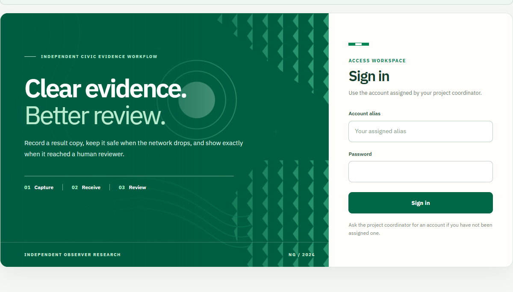
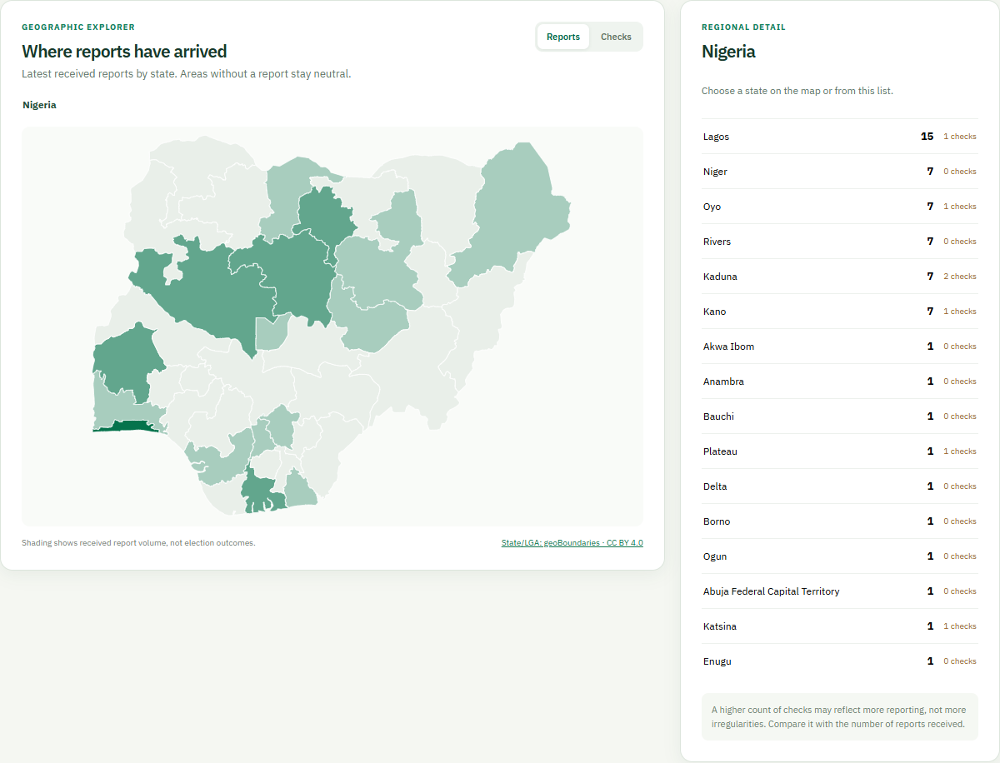
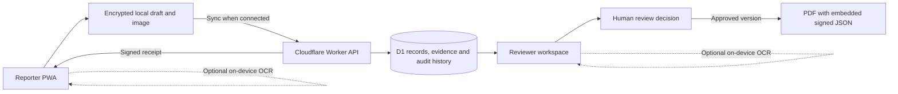

# ResultTrail · evidence capture and human review



**[Explore the screenshot walkthrough](docs/SCREENSHOT_WALKTHROUGH.md)** · **[Read the user guide](docs/USER_GUIDE.pdf)** · **[View the project slides](docs/PROJECT_DEEP_DIVE.pptx)** · **[Browse all documentation](docs/README.md)**

**Hosted site:** [resulttrail.ng](https://resulttrail.ng). The [Workers address](https://aegisrelay-app.mukhtarabdulrazaq-18.workers.dev) remains available. The site runs independently of this laptop and stores shared records in Cloudflare D1. See the [hosted deployment guide](cloud/README.md) for accounts, deployment and backups. The Python/SQLite path below is a local development demo.

A free and open-source prototype for recording a **fictional** polling-unit result copy. A reporter can save encrypted drafts, records and a source image on a device during an outage, sign in and sync later, and verify a server-signed receipt. A reviewer can inspect arithmetic checks, the source image, field-by-field comparison notes, corrections and a geographic coverage map before making a human decision. Optional on-device OCR assists both roles. Only a reviewer-approved version can produce a readable PDF with the signed minimized JSON package embedded. This is independent observer workflow research, **not an official election system**.

## Why this exists

ResultTrail was developed in response to the [AI4Elections Track 5 observation and citizen-accountability brief](https://github.com/Rise-Networks-AI-Labs/-AI4Elections-Hackathon/blob/main/docs/01_technical_briefs/track5_election_observation_accountability.md). A result-copy report can be delayed by poor connectivity, entered incorrectly, or separated from the image a reviewer needs to inspect. This project tests a traceable path from local capture to server receipt and human review. It does **not** authenticate a paper form, certify vote totals, declare fraud or represent any electoral authority. The [one-page problem statement](docs/PROBLEM_STATEMENT.md) identifies the users and narrower problem.

| Pathway | Working demonstration |
| --- | --- |
| Reporter | Generated report code, required state/LGA/ward, flexible party rows, encrypted offline draft, optional original image, retryable sync and receipt verification |
| Reviewer | Queue, state → LGA → ward map, arithmetic prompts, hash-verified source image, field-by-field notes, human decision and reporter feedback |
| Optional assistance | On-device OCR suggestions that require human acceptance or inspection; automated review ranking remains disabled |
| Export | Readable approved PDF with embedded signed JSON package and public key; the PDF page drawing itself is not digitally signed |



## How the hosted demonstration works



The browser verifies the server receipt before marking a version received. An image hash checks byte identity after upload. OCR suggestions and arithmetic checks are prompts for a person; neither makes a review decision. The [system card](docs/system-card.md) describes exactly what each signature and check can prove.

The illustrated [user guide](docs/USER_GUIDE.pdf) introduces the project and walks through both pathways, the state/LGA/ward map, OCR assistance, human comparison and PDF export. The [project deep dive](docs/PROJECT_DEEP_DIVE.pptx) explains architecture, database, code decisions, design and validation status. Both are updated as the prototype changes.

The [8 November meeting readiness check](docs/MEETING_READINESS_2026-11-08.md) records the latest live smoke test, demonstration route and remaining evidence gaps.

## Run locally

For the **hosted Worker/D1 version**, see [build, migrations, deployment and backup instructions](cloud/README.md). It uses the React/Vite client in `client/` and the Cloudflare Worker in `cloud/`. Deploying that version requires your own Cloudflare account, D1 database and signing secrets.

### Legacy local Python demo (Windows PowerShell)

From this repository directory:

```powershell
py -3.13 -m venv .venv
.venv\Scripts\python -m pip install -r requirements-dev.txt
cd client
npm ci
npm run build
cd ..
$env:AEGIS_DEMO = '1'
.venv\Scripts\python -m server.seed_demo
.venv\Scripts\python -m uvicorn server.core:app --host 127.0.0.1 --port 8000
```

Open [http://127.0.0.1:8000](http://127.0.0.1:8000). The fictional demo accounts are `reporter` and `reviewer`, each with password `demo-only-change-me`. Choose a separate **local queue passphrase** of at least 12 characters; it is not the account password. Keep the app on loopback only with these demo credentials. A domain and paid hosting are unnecessary.

If `py -3.13` is unavailable, use a Python 3.13 executable. Node 22 and npm 10 were used for the frontend. Build the frontend before starting the API so FastAPI serves the static PWA from the same origin. Demo files, database, sessions and signing key are generated under ignored `instance/`.

## Demo flow

Reporter party rows can be added or removed (2–26 rows). Codes such as `APC`, `PDP`, `LP` and `NNPP` are editable, and the arithmetic check sums every entered party score. Previously saved three-party drafts and corrections remain readable.

New reports include a three-step evidence checklist. Its confirmations and device-recorded save time are included in the signed report payload; the time is not an independent timestamp. Reporters can see a received/reviewed progress timeline and reviewer feedback across devices, and can remove individual encrypted local copies. The [privacy and retention note](docs/privacy-and-retention.md) explains the distinction between local removal and hosted records, reviewer-only geographic access, and current deletion limits.

The [review assistant build plan](docs/REVIEW_ASSISTANT_BUILD_PLAN.md) sets the delivery order and acceptance gates for OCR, ranking and historical research. The earlier [image and AI delivery plan](docs/AI_AND_IMAGE_PLAN.md) provides further storage detail. Offline encrypted image capture, signed image declarations, retryable upload and human field comparison are live. Optional OCR is available as unvalidated assistance; automated review ranking remains off.

The hosted reviewer account now has a Geographic Explorer with State → LGA → Ward drill-down, a hash-verified source-image preview and a signed-receipt verification control. The hosted demonstration includes the original 15-state illustrative sample plus [36 additional reports across six states, 18 LGAs and 36 wards](docs/GEOGRAPHIC_DEMO_DATA.md), including approved, pending, OCR comparison and correction-requested cases. The separate hackathon login handout is kept in the ignored `instance/hackathon-access.md` file.

1. Sign in as reporter, create/unlock the local vault, and start a report. The site generates a read-only `SIM-UNIT-…` code for each new report. Select the required state, LGA and ward, add each party abbreviation and vote figure shown on the illustrative source, then save. The status is **On this device**.
2. To demonstrate an outage, disconnect the browser network after its first online load, reload, choose **Open encrypted queue while offline**, unlock, and save a correction. The queued record survives another reload. Reconnect and sign in as reporter to select **Sync queued**. Older queued records missing a required location can be opened with **Edit queued report** before syncing.
3. The app checks the response digest and Ed25519 signature before showing **Server received**. A repeat of identical report ID/version/content returns the same receipt; changed content at that ID/version is rejected.
4. On the hosted site, optionally attach a JPEG, PNG or WebP source image of up to 750 KB in the reporter form, including while offline. Oversized or unsupported images show an error beside the picker. The original stays encrypted locally until sync. The signed report declares its hash; upload follows the verified report receipt and can be retried. This image feature is not part of the local Python backend.
5. Sign in as reviewer. Use the dashboard and state map to find reports; inspect the latest version, arithmetic checks, source note and image. Zoom the image and record `matches`, `possible mismatch`, `cannot read` or `not compared` for each field, with a note and append-only history. Compare changes between versions, then add an overall note and approve or request correction. **Approve** enables the export download.
6. An approved version downloads a readable PDF containing the signed minimized JSON package and public key as attachments. Extract those two JSON attachments, then verify the package from this directory:

```powershell
.venv\Scripts\python -m server.verify PATH_TO_PACKAGE.json PATH_TO_PUBLIC_KEY.json
```

## Test and evaluation

```powershell
.venv\Scripts\python -m pytest -q
.venv\Scripts\python -m server.evaluate
```

The evaluation writes [synthetic-evaluation.json](docs/synthetic-evaluation.json). Its fixed 20% review budget produced 54/84 review-worthy cases for the peer baseline and 55/84 for peer plus Isolation Forest. Incremental recall gain was 0.0119, below the predeclared 0.05 gate. **The model is disabled in the product.** These labels and groups are entirely invented and say nothing about actual elections.

To create a consistent local demo backup, stop active write traffic and run `python -m server.backup create PATH_TO_NEW_DIRECTORY`, then `python -m server.backup verify PATH_TO_NEW_DIRECTORY`. Restore to a **new** directory with `python -m server.backup restore PATH_TO_BACKUP PATH_TO_NEW_INSTANCE`; set `AEGIS_INSTANCE` to that new directory when starting Uvicorn. The backup contains the private signing key and must be kept private. Restore verifies file hashes and every stored receipt.

## Boundaries

The app accepts only fictional figures, notes and images; it does not collect real identities or official data. Map shading shows submission coverage or arithmetic checks, never election outcomes. Arithmetic flags prompt human comparison and never assert fraud. The reporter queue and draft use passphrase-wrapped AES-GCM in IndexedDB. Browser eviction, forgotten passphrases, an unlocked or compromised device, local disk failure and server key loss remain risks. This prototype is not sized or certified for a real election. See [system card](docs/system-card.md), [geographic data attribution](docs/geodata.md) and [data sheet](docs/synthetic-data-sheet.md).

The local Python/SQLite subset runs without a cloud account or metered AI API. The hosted version uses React, Vite, vite-plugin-pwa, a Cloudflare Worker and D1; the legacy local API uses FastAPI, SQLite and `cryptography`. Optional local benchmarks use scikit-learn. The app source is MIT-licensed in [LICENSE](LICENSE). Cloudflare hosting is an external proprietary service, while the application code is open source.

## OCR assistance and gated review ranking

The hosted demonstration offers optional, on-device OCR to signed-in reporters and reviewers. It reads a temporary copy of an attached image only when requested. Every reporter suggestion requires explicit acceptance; every reviewer mismatch requires inspection and a human audit action. It has not passed the independent photographed-sheet or usability gate and must not be presented as validated election OCR. Automated review ranking remains off. The [current release status](docs/RELEASE_STATUS_2026-11-04.md) records the decision and remaining checks. To reproduce the local experiments, run `py -3.13 ocr/generate_corpus.py`, `node --experimental-strip-types client/scripts/evaluate-ocr.mjs`, and `py -3.13 server/evaluate_review_ranking.py` from this directory after installing the documented Node and Python dependencies. Results are in [OCR evaluation](docs/ocr-evaluation.json) and [ranking evaluation](docs/review-ranking-evaluation.json). The generated images stay under ignored `instance/ocr-corpus/`.

The [controlled experimental demo guide](docs/EXPERIMENTAL_REVIEW_DEMO.md) documents the earlier preview workflow and the evidence-aware priority queue. The [historical source audit](docs/HISTORICAL_CONTEXT_AUDIT.md) found no comparable, validated ward-level panel for the three election years; history has no ranking weight.

A separate [public-document OCR benchmark](docs/PUBLIC_OCR_BENCHMARK.md) can evaluate numeric recognition and image-size caps on SROIE receipts or a locally supplied FUNSD copy. It does not change the 750 KB production evidence limit or satisfy the result-sheet release gate.
