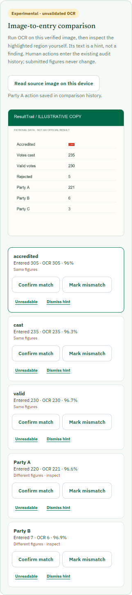

# Review-assistant acceptance status · 1 November 2026

## Completed checks

- **Reporter to reviewer:** A fictional printed sheet was attached to a report. Reporter OCR proposed figures, and a figure was accepted explicitly. Two party entries were deliberately entered differently from the sheet while keeping the arithmetic totals consistent. The report received a signed receipt and its original image was verified after sync.
- **Reviewer discrepancy:** Reviewer OCR showed Party A as **entered 220 / extracted 221** and Party B as **entered 7 / extracted 6** on that fictional sheet. A reviewer recorded a Party A possible mismatch. After page reload, the report still showed the submitted 220, the append-only comparison event, and **Human comparison follow-up** in the experimental queue. The overall report remained awaiting a separate human decision.
- **Mobile viewport:** At a 390 × 844 browser viewport, reporter image crop/processed-copy controls and reviewer image, highlights and audit buttons were exercised. Two horizontal-overflow defects were found and fixed in the OCR CSS. The revised reporter and reviewer screens had no document overflow at this viewport. This is browser emulation, not a physical-phone usability result.
- **Isolated hosted preview:** A separate Worker, D1 database, signing key and two new accounts were created. The preview has no custom-domain route to `resulttrail.ng`. Both accounts signed in; the observer was denied the reviewer API (403). A fictional report and image were synced on the preview, and reviewer OCR plus a mismatch audit action were exercised there. The private access details are in the ignored local `instance/preview-access.md` file.

## Pending acceptance evidence

No independently photographed fictional sheets were available in this session. The existing generated corpus is about 25–79 KB per image and cannot establish how ordinary phone photos behave. Physical-device tests, varied lighting/blur/skew/handwriting, second-person labels and the consented entry study in [VALIDATION_PACKET.md](VALIDATION_PACKET.md) remain pending. The screenshot above demonstrates layout and interaction only.

## 750 KB versus 2 MB image limit

The current upload limit remains **750,000 original bytes**. ResultTrail stores the original image as base64 text in one D1 row. A 2,000,000-byte original becomes roughly 2,666,668 base64 bytes before row overhead, exceeding [D1's current 2,000,000-byte string/BLOB/row limit](https://developers.cloudflare.com/d1/platform/limits/). Even a 1.5 MB original reaches the limit before metadata and SQLite overhead. Raising the form and API checks to 2 MB alone would therefore break storage.

The [D1 Free per-database cap is 500 MB](https://developers.cloudflare.com/d1/platform/limits/). At the current cap, base64 storage approaches 1 MB per image before other records and indexes, so a small demonstration can consume substantial database space. Cloudflare's [R2 Standard free allowance](https://developers.cloudflare.com/r2/pricing/) currently includes 10 GB-month storage, 1 million write-class operations and 10 million read-class operations monthly. R2 is a plausible separate object store for a 2 MB trial, with D1 retaining hash, size, ownership and audit metadata. It would require an R2 bucket and an atomicity/retry design: upload the unchanged original, verify its hash, then make it visible to reviewers only after metadata is committed. We have **not** changed storage, the limit or production behavior.

When independently photographed sheets are available, compare untouched files at 750 KB and a proposed 2 MB cap. Record camera model, original dimensions and bytes, any rejection, transfer time on mobile networks, OCR suggestions, manual readability and image hash. Decide whether the extra size improves the task enough to justify the storage change. Do not silently recompress the evidence original.

## Release state

The preview is a controlled demonstration, not validation for a public release. OCR and review priority remain off on the production site. The original OCR precision, usability and ranking-improvement gates still apply.
