# ResultTrail screenshot walkthrough

These images were captured from the hosted [ResultTrail demonstration](https://resulttrail.ng/) on **24 November 2026**, except the two PDF page images, which were rendered from the [approved example export](demo/approved-result-copy.pdf). The records, images and figures shown are invented. Counts are a snapshot and may change as the controlled demonstration is used. No passwords or private signing keys are included.

The sequence follows the two roles. A reporter records a fictional result copy and keeps an encrypted draft on the device; a reviewer inspects the received version, its source image and any OCR hints before making a human decision. The [user guide](USER_GUIDE.pdf) has step-by-step instructions; the [system card](system-card.md) explains security boundaries and limitations.

## 1. Sign in and reporter pathway

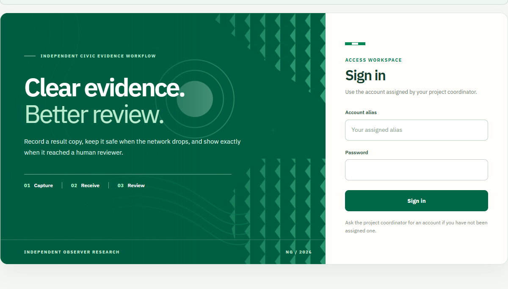

An assigned account determines whether the workspace opens as reporter or reviewer. Public self-registration is disabled. The site identifies itself as an illustrative, independent research environment.

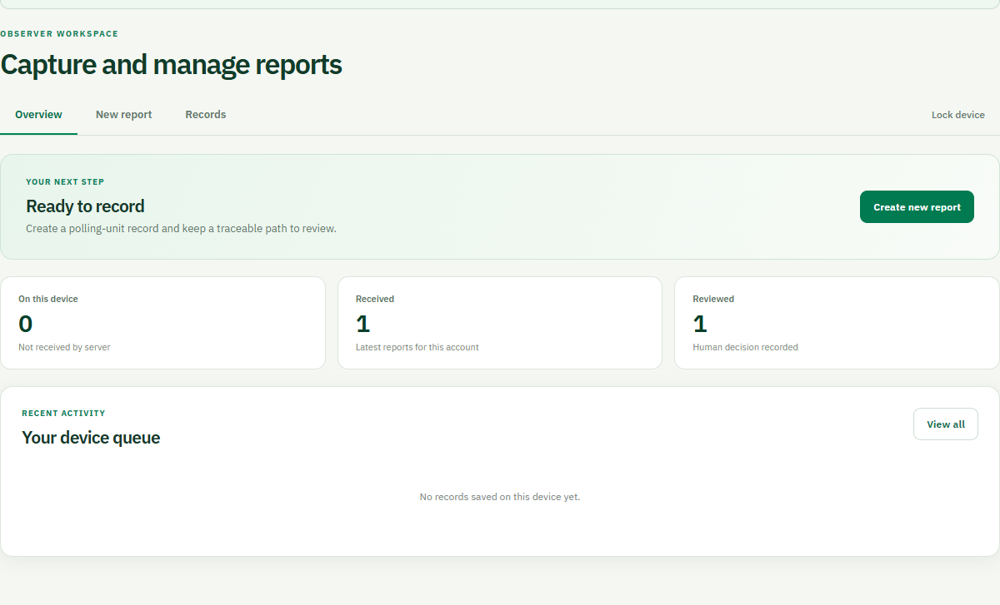

The reporter overview distinguishes records saved only on this device from those received by the shared service. A separate device passphrase encrypts the local vault; an unsynced draft cannot be fetched from another device.

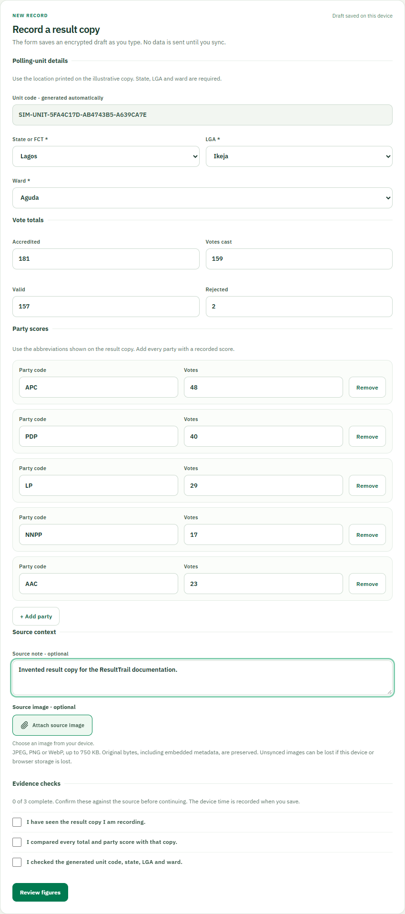

This is an **unsent local draft** filled with invented figures to demonstrate the form. The unit code is generated automatically. State, LGA and ward are required, party rows can be added, and the source image picker accepts JPEG, PNG or WebP up to 750 KB. The evidence checklist is a reporter attestation, not independent proof of capture time or authenticity.

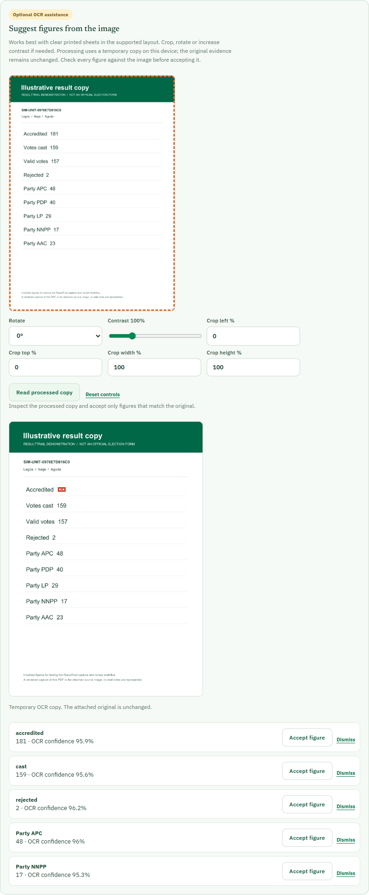

OCR runs in the browser on request. Crop, rotation and contrast affect a temporary copy; the original attached bytes stay unchanged. Each suggestion needs individual acceptance. This screenshot uses a clean computer-rendered fictional sheet, so the displayed OCR confidence values are **not** a real-world accuracy estimate.

## 2. Reviewer pathway and geographic context

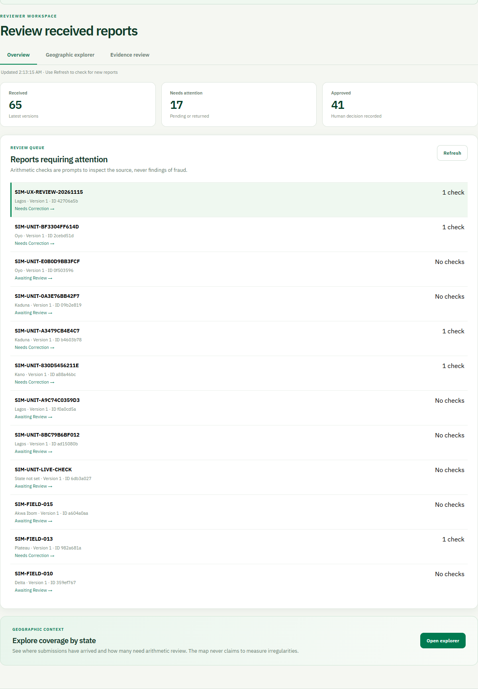

The reviewer dashboard separates received reports, reports needing attention and approved versions. Arithmetic checks prompt inspection; they do not establish fraud.

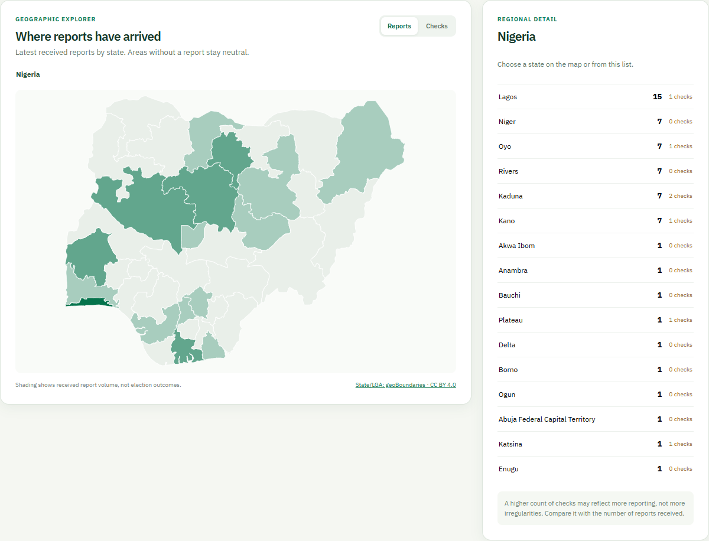

The map shades **submission coverage**, not vote totals or election outcomes. Blank areas mean no report in this illustrative workspace.

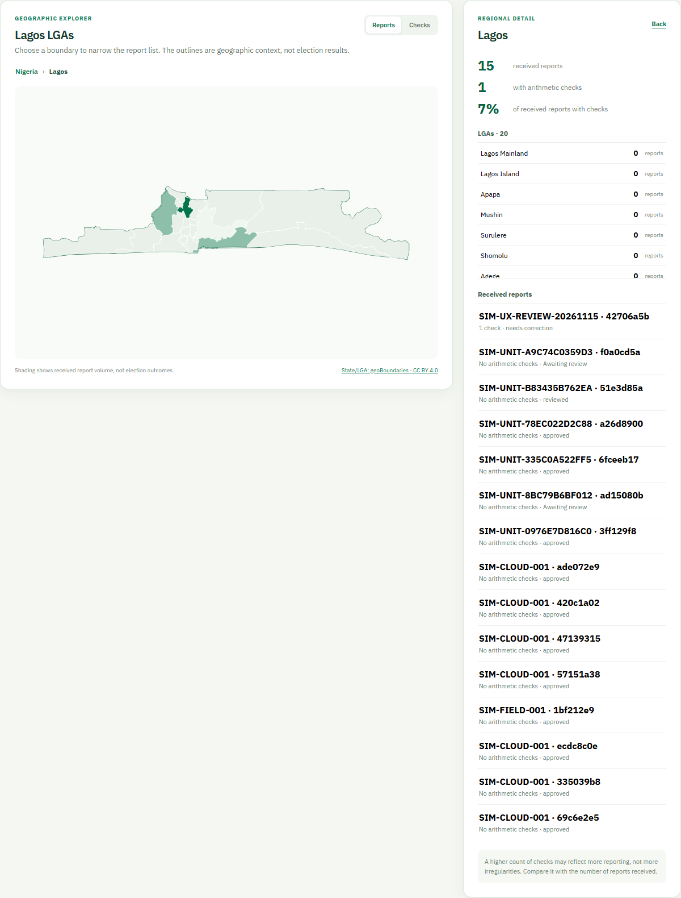

Selecting a state opens its LGA boundaries and received records. Counts include older demonstration records as well as the [36-report geographic sample](GEOGRAPHIC_DEMO_DATA.md).

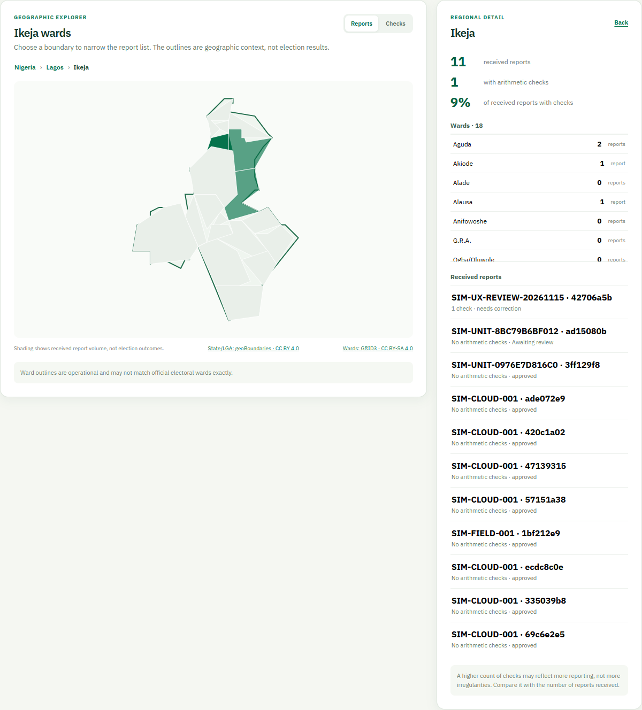

Selecting an LGA opens operational ward outlines. The ward boundaries may not exactly match official electoral wards; see [geographic attribution and limits](geodata.md).

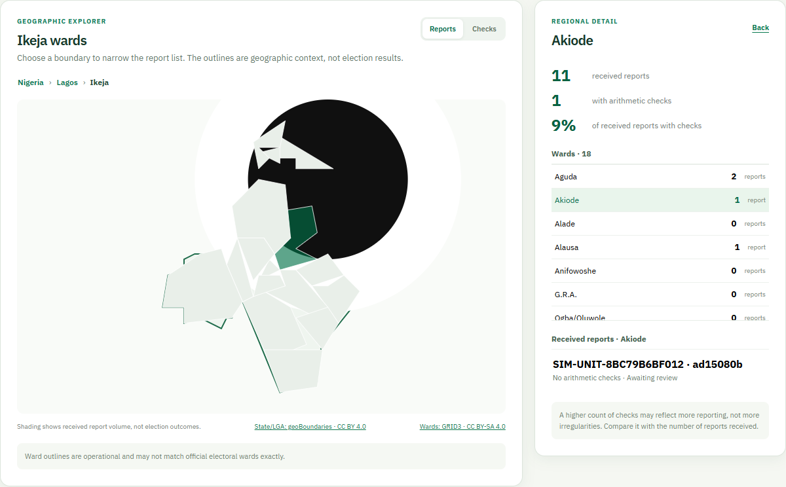

Clicking a ward narrows the received-report list. The Akiode case below was designed with a transcription difference that balanced totals do not reveal.

## 3. Evidence comparison and OCR

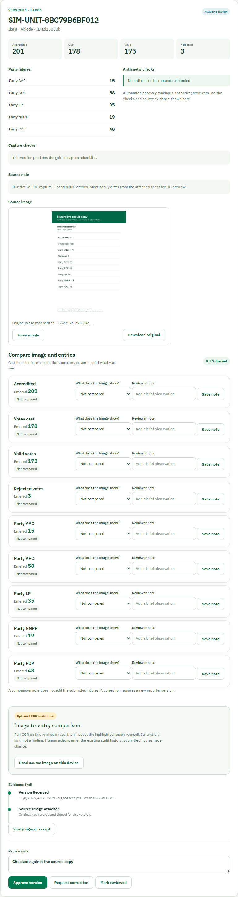

The reviewer can inspect the hash-verified original, compare each entered field against it, and record observations in an append-only history. A comparison note does not alter submitted figures; a correction requires a new reporter version.

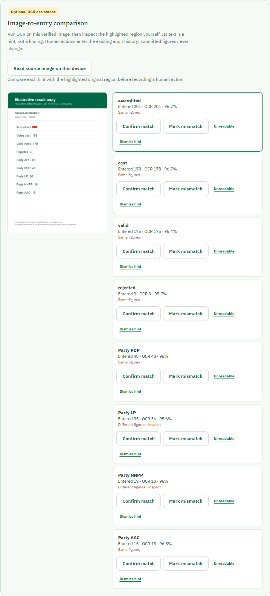

In this **deliberately constructed** Akiode example, the entered figures say LP **35** and NNPP **19**, while the attached fictional sheet says LP **36** and NNPP **18**. The live OCR suggested both differences. They are review prompts, not automated findings or decisions. For documentation, the browser's OCR results container was expanded before this screenshot so all rows appear in one image; the application data and controls were unchanged.

## 4. Human approval and PDF export

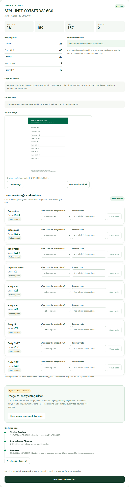

Only a reviewer-approved latest version can be exported. The example is a fictional Aguda report; its [source PDF](demo/fictional-source-sheet.pdf) was rendered to the [uploaded PNG evidence image](demo/fictional-source-sheet.png).

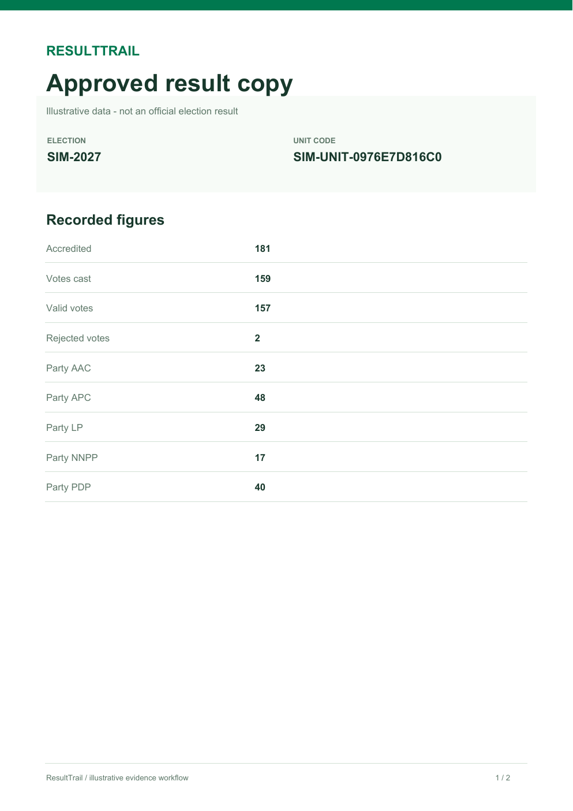

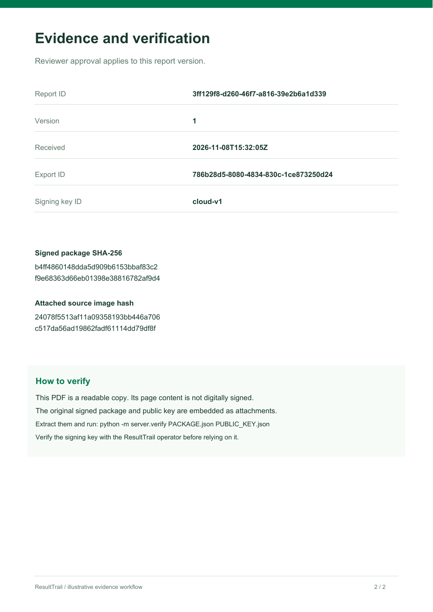

The [sample approved PDF](demo/approved-result-copy.pdf) contains readable pages and embeds the exact signed JSON package and public key as attachments. The embedded package and receipt verified with `server.verify.verify_export`; **the visible PDF pages are not themselves digitally signed**. The signature proves what this service accepted and exported, not whether a paper source or its figures were authentic.

## What these screenshots establish

They show a functioning hosted demonstration and the controls visible in its current workflow. They do not prove field reliability, source authenticity, election outcomes, suitability for operational deployment, or OCR accuracy on independently photographed sheets. See [methodology and evaluation](METHODOLOGY_AND_EVALUATION.md), [safety and limitations](SAFETY_AND_LIMITATIONS.md), and the [validation packet](VALIDATION_PACKET.md).
